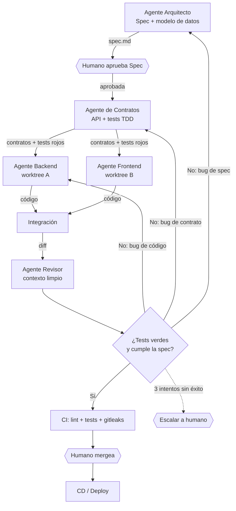

# 🤖 Multi-Agent: trabajo en equipo entre agentes

> **Ámbito de aplicación (condicional).** Esta guía **no** se aplica a toda tarea: solo
> cuando el trabajo se reparte entre **varios agentes o roles** (p. ej. un coordinador y
> varios ejecutores). Para una tarea pequeña, un único agente es más barato y más fiable.
> Cuando se active, eso sí, las reglas de esta página son **obligatorias**.

## La idea clave

"Multiagente" no significa agentes conscientes: significa **varios roles de agente, cada uno
con su propio contexto, coordinados por artefactos versionados**.

El estado compartido **no vive en el chat**: vive en el repositorio (`spec.md`, `plan.md`,
`tasks.md`, tests, informes). Cada agente lee lo que necesita, produce su artefacto y termina.
Esto da **aislamiento de contexto**, que es el verdadero motivo para usar varios agentes:
evitar que una sola ventana se contamine y acabe llena de ruido. También hace los *handoffs*
verificables: si no está en un fichero, no existe.

## Cuándo usar multiagente (y cuándo no)

| ✅ Tiene sentido | ❌ No tiene sentido |
|---|---|
| Tareas medianas o grandes con fases claras | Scripts o cambios de pocas líneas |
| Trabajo paralelizable (backend / frontend / docs) | Tareas fuertemente acopladas |
| Hace falta revisión con **contexto limpio** | Cuando coordinar cuesta más que hacer |
| La spec es estable y verificable | Requisitos aún ambiguos (antes haz `/spec`) |

## Patrones

| Patrón | Qué hace | Cuándo usarlo |
|---|---|---|
| **Orquestador + subagentes** | Un agente lee el plan, delega subtareas y resume | Tareas medianas/grandes |
| **Pipeline por fase** | Un agente por fase del SDLC | Spec-Driven Development "puro" |
| **Fan-out paralelo** | Varios agentes atacan tareas independientes | Módulos desacoplados |
| **Generador + crítico** | Uno implementa; otro revisa sin ver su razonamiento | Calidad / `/review` |
| **Debate** | Varios agentes proponen y se contrastan | Decisiones ambiguas |

## Pipeline de referencia

> 💡 El paso **"contratos antes de repartir"** es lo que permite paralelizar sin conflictos:
> backend y frontend implementan contra el mismo contrato acordado.

## Mapeo a las 6 fases

| Fase ([`master-workflow.md`](./master-workflow.md)) | Rol del agente | Artefacto que produce |
|---|---|---|
| **`/spec`** | Analista (o humano + agente) | `spec.md` (qué y por qué) |
| **`/plan`** | Arquitecto | `plan.md` + `tasks.md` |
| **`/build`** | Implementador(es) | código + commits pequeños |
| **`/test`** | QA / TDD | tests |
| **`/review`** | Revisor (**contexto limpio**) | informe `diff` vs `spec` |
| **`/ship`** | Release | CHANGELOG, versión, PR |

> **Variante TDD (opcional):** el agente de *contratos* puede escribir los tests que fallan
> **antes** de `/build`. Si no usas TDD, ese rol solo define los contratos y los tests se
> escriben en la fase `/test` como marca el [workflow](./master-workflow.md).

## Las 5 reglas de oro

1. **Artefactos como contrato.** Nada de "recuérdalo del chat". Si no está en un fichero, no existe.
2. **Contexto limpio para revisar.** El revisor ve **solo** `diff` + `spec` + tests, nunca el
   razonamiento del implementador. Si lo ve, tiende a justificarlo.
3. **Un escritor por archivo.** O `git worktree`/rama independiente por agente, para no pisarse.
4. **Verificación determinista.** Tests, linters y CI mandan: un test rojo no se "discute", se arregla.
5. **Puertas humanas.** La persona aprueba la `spec`, el `plan` y el *merge*. Ningún agente se
   auto-aprueba (ver [`guardrails.md`](./guardrails.md)).

## Bucle de feedback: enrutado y límite

Cuando el revisor dice **"no cumple"**, no todo vuelve al implementador. Hay que enrutar la causa:

| Causa | Vuelve a |
|---|---|
| Bug de **código** | Implementador |
| Bug de **contrato/test** | Agente de contratos |
| Bug de **spec** | Arquitecto (y avisa al humano) |

Y siempre con un **límite de iteraciones** (p. ej. 3). Si se agota, **se escala a una persona**:
sin límite, dos agentes pueden rebotar indefinidamente y quemar presupuesto.

## Errores comunes

| Error | Consecuencia |
|---|---|
| Pasar **resúmenes** en vez de artefactos | Se pierde información ("teléfono escacharrado") |
| Varios agentes tocando el mismo fichero | Conflictos de merge |
| Revisor que conoce el razonamiento del autor | Falsa confianza: todo le parece bien |
| Sin verificación determinista | Los agentes se dan la razón entre ellos |
| Multiagente para todo | Coste y complejidad sin beneficio |

## Cómo empezar (escalado)

1. **Nivel 0:** un solo agente con las 6 fases del [workflow](./master-workflow.md).
2. **Nivel 1:** añade **un subagente revisor con contexto limpio** (el mayor retorno).
3. **Nivel 2:** añade un **subagente de tests** (rojo → verde).
4. **Nivel 3:** paraleliza `/build` con **worktrees** (una rama por tarea independiente).
5. **Nivel 4:** un **orquestador** que lee `tasks.md` y reparte.

> No saltes al nivel 4 por moda: cada nivel añade coste de coordinación. Sube solo cuando el
> anterior se te quede corto.

## Relación con las demás reglas

- [`master-workflow.md`](./master-workflow.md): define las fases y su *Definition of Done*.
- [`guardrails.md`](./guardrails.md): consentimiento para Git y operaciones destructivas.
- Esta guía: **cómo repartir** esas fases entre varios agentes sin perder calidad.
